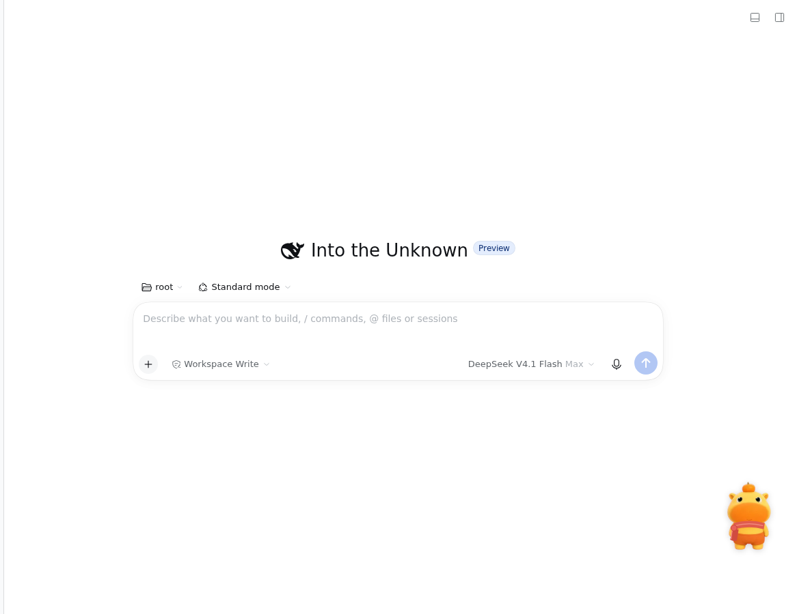

# dsh-pet

**English** · [简体中文](README.zh-CN.md)

[](package.json)
[](LICENSE)
[](https://github.com/frankfurtlin/dsh-pocket)

A capybara desktop pet for the DSH Web UI. Lulu sits in the bottom-right corner, changes pose with your sessions, and takes a head pat.



## The problem

Long agent runs are silent. A session can sit waiting for an approval, or finish a twenty-minute task, while you are looking at another window. A badge in a list is easy to ignore; something that moves on the screen is not.

## Quick example

Start a task and watch the corner:

```text
agent starts a task          → thinking pose
a tool waits for approval    → paw raised, tab title flashes 🔔 待审批
the turn ends                → celebration, bubble "Done! 12.4s, 5 tool calls."
nothing happens for a while  → sits down, then sleeps
```

Right-click her for the menu: pet, feed, focus, the twelve actions, sleep or wake up, hide for five minutes, back to the corner, settings. The interface follows the host language.

## Install

The commands below assume the checkout is at `/opt/dsh/dsh-pet` — substitute your own path if it lives elsewhere.

```sh
dsh plugin --profile web add /opt/dsh/dsh-pet
```

Refresh the page; the pet appears in the bottom-right corner. Client code is a build artifact, so after editing `client-src/` run `npm run build` and refresh. Host-side changes (routes, asset protocol) need a DSH restart.

To check the host half is mounted:

```sh
curl -s http://127.0.0.1:3080/pet/status
# → name, version, client bundle bytes, character count, asset list
```

To uninstall (this also removes the bundle entry):

```sh
dsh plugin --profile web remove dsh-pet
```

## Usage

Lulu has six states: alert, thinking, celebrate, focus, sleep and idle. They have a fixed priority, so a pending approval always outranks background work. She comes with nine SVG outfits, four sizes, 16-direction gaze, twelve actions, an intimacy level, a task counter, focus sessions, a day streak and the daily diary above. On narrow screens she is hidden by default; the settings can show her at 76 px above the bottom bar.

Click to pet (+1 intimacy, 220 ms debounce), double-click to hop. Drag her anywhere; drop her near the left or right screen edge and she snaps to it, and the position is stored as percentages so it survives a resolution change. Settings → 宠物 (or the in-place overlay from the right-click menu) holds display, character, size, reminders, sound and volume, animation, mobile display, bubble duration, doze threshold and focus lengths.

The agent can call `pet_say` with a line of up to 40 characters, plus an optional action, so a long task can talk to you from the corner. The pet also writes a daily diary to `~/.dsh/pet-diary/<YYYY-MM-DD>.json`: turns, failures, tool calls, active time and session count.

## Configuration

There is no `dsh` config block and no environment variable you must set. Everything the user tunes is in the settings pane and stored per browser in `localStorage`:

| Key | Contents |
|---|---|
| `dsh-pet:settings:v1` | Display, character, size, reminders, sound/volume, animation, mobile, bubble duration, doze threshold, focus and break lengths |
| `dsh-pet:growth:v1` | Intimacy, task count, focus count, day streak |
| `dsh-pet:migrate:v2-single-lulu` | One-shot migration marker for the old `pilot` character id |

Storage is per browser on purpose: one host can serve several people, so pet preferences must not overwrite each other. Export/import covers a new browser.

Optional host environment variables: `DSH_HOME` (default `~/.dsh`), `DSH_PET_SKINS_DIR` (default `$DSH_HOME/pet-skins`) and `DSH_PET_DIARY_DIR` (default `$DSH_HOME/pet-diary`).

The bundle declares no `engines.dsh` range and no `dsh` peer range. A version range is the most common reason a plugin disappears entirely after a DSH upgrade; this one only touches the public `slots`, `sessions`, `locale` and `uiSession` services.

## What it doesn't do

- It does not ship other community characters. Only Lulu is bundled (see Acknowledgments); other pets stay outside the repository.
- Custom images stay simple. A static picture only breathes, tilts and casts a shadow; a single animation loop cannot switch pose per state. Per-state motion needs the Codex sprite-sheet protocol.
- The twelve actions are locally drawn or generated. Image-to-video generation changed proportions and erased small details, and one clip left the frame entirely, so the generated set is uneven.
- There is no voice pack, no second personality and no balance or usage display.
- Sound is synthesized with WebAudio; richer sound would need licensed audio files.
- Headless Chromium without CJK fonts renders Chinese bubble text as boxes in screenshots. The text itself is correct.

## Acknowledgments

- **Lulu sprite sheet**: [czy666chen/lulu](https://github.com/czy666chen/lulu) (sheet) and [srwang0506/HatchPet-CapybaraLulu](https://github.com/srwang0506/HatchPet-CapybaraLulu) (source frames and build scripts), **MIT / Apache-2.0**.
- **Idle loop and action videos**: generated locally from that material with `Wan-AI/Wan2.2-I2V-A14B` and `MiniMax-Video-H3-Max`. They are derived from the MIT/Apache-2.0 assets and are for local use.
- **Interaction design**: the right-click action playback and intent arbitration were inspired by [`@luweiyabo/dsh-whale-pet`](https://github.com/luweiyabo/dsh-whale-pet) (MIT). No assets were copied.
- **Local-only material**: the Douyin and Xiaohongshu fan re-creations under `images/` are not bundled and not distributed.
- Earlier characters (布布 / 团团 / 像素鸭 / 咕咚 / 薄荷) were removed at the user's request; their assets are kept outside the repository with their own licenses (MIT / MIT / MIT / CC BY 4.0 / MIT).

The plugin replaces `@michengai/dsh-codex-pet` and `dsh-whale-widget`, which were uninstalled.

## Docs

The Chinese README is the full reference: [README.zh-CN.md](README.zh-CN.md). Sections worth opening:

- **自备形象**: the image and animation import pipelines, and what they can and cannot express.
- **素材来源与许可**: complete asset credits, licensing rules and source-material notes.
- **开发**: build, tests, the host routes and the directory layout.
- **几个设计取舍**: why a hand-written bundler, why there is no `engines.dsh` range, and the bugs those choices came from.
- **验收记录**: recorded browser acceptance runs, with screenshots.
- **已知边界** and **提交约定**: the remaining limits and the commit format.

Acceptance reports, screenshots and JSON results live under `docs/verification/pet/`.

## Contributing

Run `npm run build`, `npm run check` and `npm test` before sending a patch; for visible changes also run `npm run verify` (Playwright and a real Chromium). One change per commit, Conventional Commits.

## License

MIT — see [LICENSE](LICENSE).
